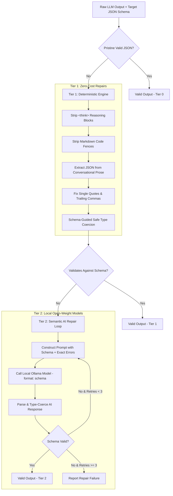

# StructFix

> **Lightweight, local-first Python CLI harness to repair malformed LLM JSON output.**

StructFix maximizes the chance of valid JSON output from Large Language Models by pairing free, instant deterministic repair (Tier 1) with an intelligent, bounded open-weight AI fallback loop (Tier 2).

---

## The Problem

LLMs frequently output broken JSON:
- Markdown fences (` ```json ... ``` `) and `<think>` reasoning blocks
- Conversational preambles (*"Sure! Here is your data: ..."*)
- Single quotes and trailing commas
- Primitive types encoded as strings (`"30"` instead of `30`)
- Truncated or semantically disordered schemas

Existing approaches either only handle simple syntax errors or force heavy frameworks. StructFix provides a decoupled, local-first repair pipeline that can fix syntax deterministically in under 1 millisecond, or engage a lightweight local model via Ollama with strict zero-hallucination policies.

---

## Architecture



---

## Quick Start

### 1. Installation

```bash
git clone https://github.com/your-username/structfix.git
cd structfix
pip install -e .
```

### 2. Setup Local Model (Ollama)

Tier 2 uses small local open-weight models via [Ollama](https://ollama.com):

```bash
# Pull default model (Qwen 3 1.7B)
ollama pull qwen3:1.7b

# Or alternative model (Llama 3.2 3B)
ollama pull llama3.2
```

---

## Usage

### CLI

```bash
# Basic repair
python -m structfix --input broken.json --schema schema.json

# Using a specific local model with verbose logs
python -m structfix --input broken.json --schema schema.json --model qwen3:1.7b --verbose

# Deterministic Tier 1 only (no Ollama required)
python -m structfix --input broken.json --schema schema.json --no-tier2
```

> **Note**: Clean valid JSON is written to `stdout`, while diagnostic logs and warnings go to `stderr`. Exit codes: `0` (Success/Recovered), `1` (Unrepairable), `2` (CLI Usage error).

### Python API

```python
from structfix import repair

raw_llm_output = "```json\n{'name': 'Alice', 'age': '30',}\n```"
schema = {
    "type": "object",
    "properties": {
        "name": {"type": "string"},
        "age": {"type": "integer"}
    },
    "required": ["name", "age"]
}

result = repair(raw_llm_output, schema=schema)

if result.is_valid:
    print(result.data)
    # Output: {'name': 'Alice', 'age': 30}
    print(f"Tier used: {result.tier_used}, latency: {result.latency_ms:.2f}ms")
```

---

## How Tier 2 Works

When deterministic rules cannot satisfy the JSON Schema, StructFix initiates a bounded AI repair loop:
1. **Targeted Prompting**: Provides the original output, target JSON Schema, and exact JSONPath validation errors.
2. **Strict Non-Fabrication Rule**: The repair prompt strictly mandates: *"NEVER invent values. If a required field cannot be recovered from the original text, you must return null for it."*
3. **Structured Format Enforcement**: Uses Ollama's schema-constrained decoding (`format` parameter) with `temperature=0.0` and reasoning tokens disabled (`think: false`).
4. **Bounded Retries**: Loops at most 3 times, feeding new schema errors back to the model before marking unrecoverable fields.

---

## Comparison with Existing Tools

| Tool | Approach | Local / Offline | Schema Validation | Semantic Recovery | Zero-Hallucination Policy |
| :--- | :--- | :---: | :---: | :---: | :---: |
| **StructFix** | Two-tier hybrid (Deterministic + Local LLM fallback) | Yes (100% local) | Yes (JSON Schema) | Yes (Bounded retry) | Yes (Explicit `null` tracking) |
| **json-repair** | Pure deterministic regex & character scanner | Yes | No | No | N/A |
| **Instructor** | Pydantic validation around API provider calls | Depends on provider | Yes (Pydantic) | Yes (Provider retries) | Model-dependent |
| **Guardrails AI** | Full framework with server & validator interceptors | Configurable | Yes (Pydantic/Rail) | Yes | Framework-dependent |

---

## Benchmarks

Run the benchmark suite against test fixtures:

```bash
python scripts/benchmark.py --models qwen3:1.7b llama3.2
```

*Results vary based on local hardware and Ollama server availability. Metrics are computed dynamically during runtime.*

---

## Limitations

- **Complex Domain Business Logic**: StructFix repairs syntax and schema structural conformance; it cannot verify whether a factual statement in the JSON is empirically true.
- **Unrecoverable Data**: If a required attribute is omitted entirely from the input text, StructFix sets it to `null` to avoid hallucination rather than inventing fake data.

---

## Model Attribution & Licenses

- **Qwen3 (Qwen 3 1.7B)**: Developed by the Qwen Team, Alibaba Cloud. Licensed under the [Apache License 2.0](https://www.apache.org/licenses/LICENSE-2.0).
- **Llama 3.2 (3B / 1B)**: Developed by Meta Platforms, Inc. Licensed under the [Llama 3.2 Community License](https://github.com/meta-llama/llama-models/blob/main/models/llama3_2/LICENSE).

---

## License

StructFix is distributed under the [MIT License](LICENSE).
